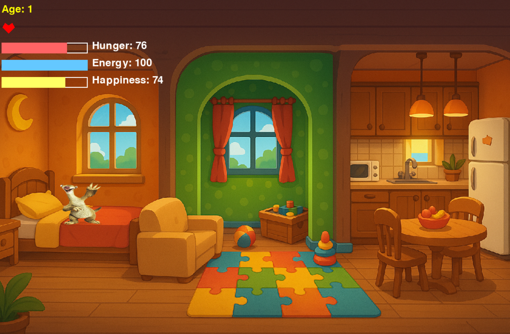

# Meet with Alish – Digital Pet Game

Keep your digital pet Alish fed, rested and happy, or he loses his hearts. A small real-time game built with Python and Pygame, and a team project on object-oriented game logic, timers and graphics.



## Highlights

- **Three rooms with different effects**: Bedroom (left), Play Area (centre) and Kitchen (right)
- **Real-time stats**: hunger, energy and happiness (0–100) shown as coloured bars, health as 5 hearts, plus an age counter
- **Stat decay**: every 5 seconds (every 3 seconds in the Play Area) hunger and energy drop by 5 and happiness by 7. Happiness falls faster when Alish is hungry or tired (below 40).
- **Health system**: when any stat reaches 0, Alish loses a heart and the stats refill. With no hearts left, the game is over.
- **Ageing**: Alish grows one year older every 60 seconds
- **Start and Game Over screens** with START and RESTART buttons
- **OOP design**: a `Pet` class holds the stats and the actions

## How to play

| Zone | Effect per second |
|---|---|
| Kitchen (right) | Hunger +10 (an apple appears) |
| Bedroom (left) | Energy +10 |
| Play Area (centre) | Happiness +7, hunger -3, energy -3 (a toy appears) |

| Control | Action |
|---|---|
| Arrow keys | Move Alish (he stays in the lower half of the house) |
| Mouse click | START on the start screen, RESTART on the Game Over screen |
| Close window | Quit |

## Project structure

| File | Description |
|---|---|
| `main.py` | Standalone game: start screen, game loop, zones, stats, Game Over screen |
| `pet.py` | `Pet` class (stats and actions), used by `main.py` |
| `constants.py` | Window size, frame rate and timing constants, used by `main.py` |
| `Digital_Pet_Alish.ipynb` | The same game as a notebook, with every step explained in markdown |
| `assets/` | Sprites and background: `alish.png`, `apple.png`, `toy.png`, `heart.png`, `house_background.png`, `preview.png` |
| `requirements.txt` | Python dependencies |

## How to run

```bash
cd digital-pet-game
pip install -r requirements.txt
python main.py
```

The requirements use [pygame-ce](https://pyga.me/), a drop-in replacement for Pygame (the code still uses `import pygame`) with builds for current Python versions, including 3.14.

To follow the code step by step, open the notebook instead (`jupyter notebook Digital_Pet_Alish.ipynb`) and run all cells; the last code cell runs the game loop. Closing the game window there ends the loop with `sys.exit()`, which Jupyter reports as a `SystemExit`. This is expected; restart the kernel to play again.

## Contributors

| Name | Contribution |
|---|---|
| **Mehdi Gurbanzade** | Technical setup and visuals: set up the Pygame environment and game window, coded the movement system (keyboard controls, staying inside the screen), built the zones (Kitchen, Bedroom, Play Area) and their effects on the stats |
| **Jahangir Guluzade** ([@theguluzada](https://github.com/theguluzada)) | Logic and pet system: came up with the main idea of the digital pet Alish, designed the roadmap and overall project structure, helped write the project description and goals |

Work packages were divided between both team members and progress was discussed in team meetings.

## Limitations and next steps

- The `Pet` methods `feed()`, `play()`, `rest()` and `decay_stats()` are defined but the game loop updates the stats directly. Moving that logic into the class would make the code cleaner.
- The notebook defines its own copy of the `Pet` class and constants instead of importing `pet.py` and `constants.py`.
- Ideas from the project goals: more rooms, animations, and sound.

**Authors:** Mehdi Gurbanzade · M.Sc. Data Science, and Jahangir Guluzade
